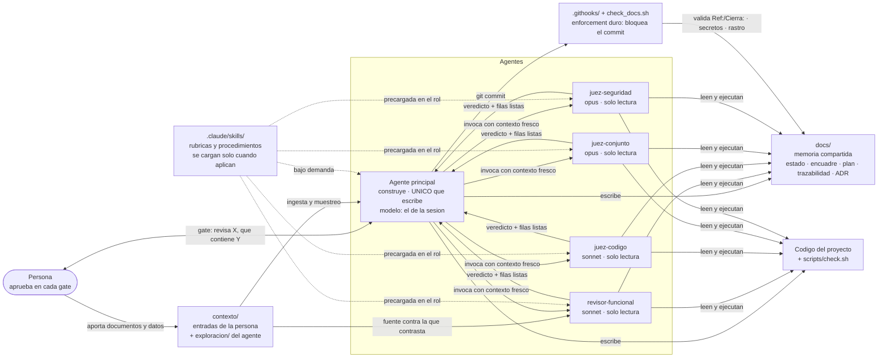
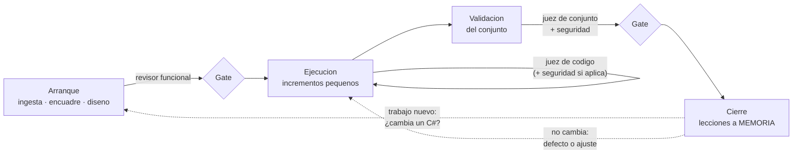

# Plantilla para desarrollar software con agentes de IA

Estructura base para trabajar con un agente de IA (Claude Code, Codex, Cursor…)
de forma **segura y estructurada** en proyectos de software. No es un proyecto en
sí: es una plantilla que copias a tu proyecto real. El agente la sigue paso a
paso, con una **compuerta humana entre cada fase**, antes de escribir la primera
línea de código.

Lo que esta plantilla configura no es un agente sino un **sistema agéntico**: varios
agentes con roles, permisos y memoria distintos, coordinados bajo compuertas humanas.
Un **agente principal** conduce el arranque, construye el código y es el **único con
permiso de escritura**. Cuatro **revisores independientes** (revisor funcional, juez de
código, juez de conjunto y juez de seguridad) arrancan con contexto propio, solo leen y
ejecutan, y devuelven un veredicto PASA/FALLA con las filas listas para que el principal
las registre. Las **skills** son los procedimientos que cada rol carga solo cuando
aplican; `docs/` es la memoria compartida (un lugar por dato, `estado.md` como punto de
reentrada); y lo que no puede fallar vive en **hooks de git**, no en prosa. El detalle de
cada pieza está en «Cómo está armado el sistema» y en el glosario de «Definiciones».

## Cómo usarla

1. Copia el contenido de este repo a tu nuevo proyecto.
2. El agente ejecuta primero el **Bootstrap (paso 0)**: verifica que git esté
   configurado, que los hooks estén activos (`git config core.hooksPath .githooks`),
   que `.env*` esté ignorado y que exista un **remoto** con push inicial — o que
   declares el proyecto como **PoC sin remoto** (excepción explícita; nada llega a
   producción sin remoto). Se hace un commit **al cierre de cada fase y de cada
   incremento** (no solo en la ejecución).
3. **Deja primero tus entradas en `contexto/`.** Es la **única carpeta de entrada**:
   documentos (antecedentes, specs, notas), datos de entrada y de salida, notebooks y
   resultados previos van todos a su raíz, **sin clasificarlos** —el agente los tipifica
   al ingerir—. Es **obligatoria**: necesita al menos un archivo para arrancar —si no
   tienes documentos, escribe un brief breve (guía: `docs/plantilla-requerimiento.md`)—,
   porque el encuadre se **deriva de las entradas**, no de lo que alcances a teclear en
   frío. Todo sistema tiene **entradas y salidas** (archivos, tablas, APIs, pantallas,
   artefactos): deja muestras reales de cada una, o el acceso para obtenerlas; si el
   insumo vive detrás de un servicio o una base de datos, el agente te pedirá
   **conexión/credenciales** para muestrear datos reales antes de suponer.
4. Pídele al agente que ejecute `docs/arranque.md`. Ese guion **empieza ingiriendo
   tus entradas**: inventaría lo que hay, te pregunta si está completo, te propone a
   dónde va cada cosa (gate) y arma un borrador de `docs/encuadre.md`. Recién después
   viene el encuadre, que es **revisar y completar** ese borrador —no llenarlo desde
   cero—, seguido del diseño y la validación. Hay un gate en cada actividad, **antes de
   programar**.

## Las 5 fases (con compuerta humana entre cada una)

1. **Encuadre** — contexto, objetivos, no-objetivos, criterios de éxito, set de
   oro, stack y arquitectura, modelo de despliegue —destino local/remoto y
   empaquetado, contenedor recomendado— (`docs/encuadre.md`).
2. **Diseño / plan** — enfoque mínimo e incrementos (`docs/plan.md`); la arquitectura
   se valida con la persona en el README (diagrama gerencial), iterando hasta su OK.
   Antes del gate, el encuadre y el plan pasan una **revisión funcional
   independiente** que verifica completitud y consistencia contra `contexto/`
   (reporta, no escribe).
3. **Ejecución iterativa** — incrementos pequeños, verificados sobre datos reales,
   con revisión crítica independiente antes de cada commit.
4. **Validación** — el conjunto ensamblado contra los `C#` y el set de oro, con
   pasada del juez sobre el conjunto (`docs/definicion-de-hecho.md`).
5. **Cierre y aprendizaje** — lecciones a `docs/MEMORIA.md`.

Además, cuando el proyecto llega a producción, se abre la rebanada de
**Operación/Despliegue** (`AGENTS.md` §2): entorno de prueba, runbook verificado,
protección de datos y autorización explícita, con su propia pasada de juez
(`.claude/skills/desplegando-a-produccion/SKILL.md`).

## Cómo está armado el sistema

Una foto de las piezas y sus relaciones permanentes (sin tiempo: quién invoca, quién
escribe, qué se precarga, qué bloquea). Lo que hace visible: la **asimetría de
permisos** (una sola flecha «escribe»), la **independencia de contexto** de los
revisores (solo reciben la invocación, no la memoria del principal), el **modelo por
rol** y que el enforcement actúa sobre el **commit**, no sobre el agente.



Los roles están declarados en `.claude/agents/` (herramientas, modelo y skill
precargada) y su rúbrica en `.claude/skills/`; ver `.claude/skills/README.md` §Roles.

## Diagrama de la metodología

El orden en que ocurre todo y dónde interviene cada control —la persona en los gates,
una revisión independiente en tres momentos—. Primero el mapa, en siete nodos:



El juez aparece tres veces porque son tres momentos; en el diagrama de componentes
aparece una vez porque es una pieza. Abajo, el mismo flujo con todos los gates y
condiciones de salida.

El flujo completo: el **arranque** (antes de programar, con `contexto/` como
precondición y un gate por actividad) y el **ciclo de vida** (la Fase 3 es un bucle que se
cierra con el juez y la Definición de Hecho). Las dos revisiones independientes —el
**revisor funcional** sobre el encuadre y el **juez** sobre el código— son los puntos
donde otro contexto verifica el trabajo. Y un **arco de reentrada**: el trabajo nuevo
que llega tras la Fase 5 se clasifica con una sola pregunta —¿cambia `encuadre.md` (un
`C#` o el set de oro)?— y vuelve al **Encuadre** si la respuesta es sí, o salta directo a
la **Fase 3** si es no.

```mermaid
flowchart TD
    Start(["El agente abre AGENTS.md y ejecuta docs/arranque.md"]) --> Boot

    subgraph ARR["ARRANQUE · antes de la primera linea de codigo"]
      direction TB
      Boot["Paso 0 · Bootstrap del repositorio<br/>hooks activos, .env ignorado,<br/>remoto con push inicial o PoC declarada"]
      Boot --> Pre{"¿contexto/ tiene 1+ archivo real?<br/>precondicion dura"}
      Pre -->|No| StopMat["Detente y pide entradas<br/>documento o brief breve"]
      StopMat -.-> Pre
      Pre -->|Si| P1["Fase 1 · Ingesta<br/>inventariar y tipificar contexto/<br/>rutear, sembrar docs vivos<br/>entradas y salidas del sistema: muestreo<br/>1-3 ejemplos reales de cada una<br/>(pide conexion a servicios/BD si aplica)"]
      P1 --> G1{"Gate: ¿set de entrada completo<br/>y ruteo aprobado?"}
      G1 -->|No| P1
      G1 -->|Si| P2["Fase 1 · Encuadre<br/>revisar y completar el borrador de encuadre.md<br/>marcar origen: de contexto/ / inferido / FALTA<br/>set de oro con ejemplo entrada a salida<br/>despliegue: destino local/remoto y empaquetado<br/>alcance del rastro decidido"]
      P2 --> G2{"Gate: ¿encuadre confirmado, sin FALTA,<br/>inferido ni ADR propuesta pendiente?"}
      G2 -->|No| P2
      G2 -->|Si| P3["Fase 2 · Diseño<br/>plan minimo e incrementos en plan.md<br/>modelo de datos de salida si aplica (contrato)<br/>diagrama gerencial en README, validado con la persona<br/>fuera de alcance explicito"]
      P3 --> P4["Fase 2 · Revision funcional independiente (rol analista)<br/>revisor funcional · revision-funcional<br/>encuadre y plan vs contexto/ · reporta, no escribe<br/>los vacios que halla se llaman R-E.n"]
      P4 --> RF{"¿Veredicto PASA y<br/>sin vacios R-E.n abiertos?"}
      RF -->|"Falla: vacio"| Fill["La persona llena el hueco:<br/>escribe en el .md o agrega documento"]
      Fill --> P4
      RF -->|Pasa| P5["Fase 2 · Registro<br/>decisiones como ADR en decisiones.md<br/>estado.md sembrado"]
      P5 --> GD{"Gate de diseño:<br/>¿la persona aprueba el plan?"}
      GD -->|No| P3
    end

    GD -->|Si| EXEC

    subgraph CICLO["CICLO DE VIDA · Fase 3 en adelante"]
      direction TB
      EXEC["Fase 3 · Ejecucion iterativa<br/>un incremento pequeño y revisable"]
      EXEC --> Vreal["Verificacion sobre datos reales<br/>no solo fixtures sinteticos"]
      Vreal --> Judge["Juez de codigo · revision-critica<br/>revision critica independiente<br/>hallazgos R-I#.n"]
      Judge --> JV{"¿PASA?"}
      JV -->|Bloqueantes| FixB["Resolver subtareas<br/>commit Cierra: R-I#.n"]
      FixB --> Judge
      JV -->|Si| DoD{"¿Cumple la Definicion de Hecho?<br/>incluye README al dia y compactacion:<br/>estado.md regenerado, bitacora podada"}
      DoD -->|No| EXEC
      DoD -->|Si| Commit["Commit enlazado Ref: / Cierra:<br/>plan y trazabilidad al dia"]
      Commit --> More{"¿Quedan criterios C#<br/>sin verificar?"}
      More -->|Si| EXEC
      More -->|No| F4{"Fase 4 · Validacion del conjunto<br/>¿cumple los C# y el set de oro a la vez,<br/>integrado y sobre datos reales?<br/>pasada del juez + mutation testing informativo"}
      F4 -->|"No: defecto o regresion"| EXEC
      F4 -->|"Si"| F5["Fase 5 · Cierre y aprendizaje<br/>lecciones a docs/MEMORIA.md, luego skills<br/>handoff: el agente avisa que lo planeado se cumplio"]
    end

    EXEC -.->|"si el trabajo impacta produccion"| OPS["Rebanada Operacion/Despliegue<br/>desplegando-a-produccion<br/>entorno de prueba, runbook verificado,<br/>respaldo de datos, autorizacion explicita"]
    OPS -.-> EXEC

    F4 -->|"No: encuadre erroneo o requisito nuevo<br/>ajustar contexto + ADR"| P2

    F5 --> End(["Cierre del ciclo"])

    End -.->|"llega trabajo nuevo<br/>no re-ejecuta arranque,<br/>solo la rebanada necesaria"| TR{"Reentrada - triage<br/>¿cambia encuadre.md?<br/>un C# o el set de oro"}
    TR -.->|"No: defecto, regresion<br/>o ajuste interno: a Fase 3"| EXEC
    TR -.->|"Si: ajuste edita un C# o<br/>requisito nuevo agrega uno: a Encuadre"| P2
    TR -.->|"pregunta o mejora opcional:<br/>no abre ciclo"| Soporte["Responder o backlog"]
```



## Definiciones

Glosario de los términos y siglas que usa la metodología (y el diagrama):

- **Agente** — entidad que recibe un objetivo, observa su entorno con herramientas
  (lee archivos, ejecuta comandos), decide la siguiente acción y actúa, en bucle, hasta
  cumplirlo o detenerse. Aquí son agentes el principal y cada uno de los cuatro revisores.
- **Agente principal** — el que ejecuta `docs/arranque.md`, conduce a la persona,
  construye el código y registra el rastro. Es el **único con permiso de escritura**;
  hereda el modelo de la sesión.
- **Revisor / subagente** — rol declarado en `.claude/agents/` que el principal invoca
  con **contexto fresco** (no hereda su memoria), herramientas acotadas a lectura y
  ejecución (`Read, Grep, Glob, Bash`), rúbrica precargada desde `.claude/skills/` y
  modelo fijo. **Reporta, no escribe:** devuelve veredicto y filas listas; el principal
  las registra.
- **Sistema agéntico** — el conjunto: los agentes, el **reparto de permisos** entre
  ellos, la **memoria compartida** en `docs/`, las **compuertas humanas** y el
  **enforcement** en hooks. Es lo que esta plantilla configura; ningún agente por sí solo
  lo es.
- **Encuadre** — Fase 1: definir el *problema* (contexto, objetivos, no-objetivos,
  criterios, set de oro, stack, despliegue) antes de diseñar nada. Vive en
  `docs/encuadre.md`.
- **No-objetivos** — lo que queda **fuera de alcance a propósito**. El primer freno al
  sobredimensionamiento.
- **Gate / compuerta** — punto donde la persona **aprueba explícitamente** antes de
  avanzar. No se sigue sin su OK.
- **Bootstrap (paso 0)** — precondición del arranque: hooks activos, `.env` ignorado y
  remoto con push inicial (o **PoC declarada**). Sin esto, el agente se detiene.
- **Modo PoC declarada** — la persona declara el proyecto como prueba de concepto:
  relaja remoto, muestreo y tamaño del set de oro **de forma explícita y registrada**;
  no relaja gates, juez ni ADRs. Su promoción a producto exige las condiciones plenas.
- **`contexto/`** — la **única carpeta de entrada** (obligatoria, ≥1 archivo): documentos
  que se leen y artefactos que se ejecutan o inspeccionan (notebooks, datos de entrada
  y de salida, resultados previos) conviven en su raíz; la persona no clasifica, el
  agente **tipifica** al ingerir (manifiesto en `contexto/README.md`). Su subcarpeta
  `exploracion/` es trabajo del agente (muestreo, experimentos), no fuente.
- **Ingesta** — leer e inspeccionar las entradas de `contexto/`, tipificarlas y
  **rutearlas** a los archivos oficiales (`encuadre.md`, `decisiones.md`,
  `convenciones.md`), inventariando las entradas y salidas del sistema.
- **Entradas y salidas** — toda frontera que el sistema consume o expone (archivos,
  tablas, APIs, eventos, pantallas, artefactos). Cada una es una fila en
  `docs/encuadre.md` §Entradas y salidas con su muestra real en `contexto/` y si fue
  **validada**; el revisor funcional contrasta la tabla contra la carpeta.
- **Insumo** — cualquier **entrada real** del sistema: datos, archivos, respuestas de
  API, conexiones a servicios o bases de datos.
- **Muestreo de insumos reales** — abrir **1 a 3 ejemplos reales** de cada insumo y
  validar contra ellos los supuestos del spec (formato, nombres, casos límite) antes de
  diseñar — pidiendo conexión/credenciales si el insumo vive en un servicio. Barato, y
  evita rediseñar a mitad de camino.
- **Experimento mínimo** — validación barata (en `contexto/exploracion/`) de un **supuesto
  técnico** que condiciona un incremento, antes de construir sobre él. Su resultado es
  un hallazgo; rehacer cuesta más que el experimento.
- **Set de oro** — ≥5 pares `entrada → salida esperada` que definen la **calidad
  aceptable** (no solo que "funcione"), con al menos un ejemplo concreto (en PoC
  declarada: mínimo 2–3).
- **Stack** — el lenguaje, framework, build y estilo de arquitectura elegidos.
- **Hallazgo** — un **hecho observado** (p. ej. en el muestreo: "el prototipo no
  implementa el filtro de frescura"). Se **registra como dato** en `docs/encuadre.md`;
  **no es una decisión**. Solo cuando fuerza una elección (≥2 opciones) genera un ADR.
- **ADR** (*Architecture Decision Record*) — registro **ligero** de una decisión que
  tenía más de una opción razonable: contexto, opciones, decisión, razón y
  consecuencias. Viven en `docs/decisiones.md`. Un ADR en estado **`propuesta`** es una
  **decisión diferida**; uno superado se marca **`reemplazada-por:`/`revertida-por:`**
  en su propio estado.
- **Alias** — slug de 2–4 palabras que acompaña a cada `C#`, `I#` y hallazgo
  (`I5 «motor-indicadores»`) para citarlos sin releer documentos. Vive en la columna
  Alias de `docs/trazabilidad.md` (y en `plan.md` para los `I#`).
- **`docs/estado.md`** — el **punto de reentrada** de cada sesión: una página con la
  fase, los criterios con alias y estado, lo abierto y el próximo paso. Se regenera al
  cierre de cada incremento; los demás documentos se abren solo por rebanada.
- **Definición de Hecho** (*DoD, Definition of Done*) — checklist de calidad que un
  incremento debe cumplir para considerarse terminado (`docs/definicion-de-hecho.md`).
- **Revisor funcional (rol analista)** — revisión **independiente** del *encuadre y el
  plan* contra su fuente, al cerrar el arranque. **Reporta, no escribe**
  (`.claude/skills/revision-funcional/SKILL.md`).
- **Juez (rol juez)** — revisión **independiente** del *código* (el diff de cada
  incremento) antes del commit. **Reporta, no edita** (`.claude/skills/revision-critica/SKILL.md`).
- **Juez de seguridad (rol juez)** — auditoría **independiente** de lo *explotable*
  (inyección, control de acceso, secretos, dependencias, IaC, prompt injection), solo
  cuando el incremento toca superficie de riesgo, y una vez sobre el conjunto. Severidad
  × explotabilidad, con confianza. **Reporta, no corrige**
  (`.claude/skills/revision-seguridad/SKILL.md`).
- **Rebanada de Operación/Despliegue** — cómo entra a producción el trabajo: entorno
  de prueba, runbook verificado, protección de datos, autorización explícita y juez
  (`.claude/skills/desplegando-a-produccion/SKILL.md`).
- **Reentrada / triage** — cómo entra el trabajo nuevo *después del cierre* (Fase 5): lo
  **dispara el cierre** y **no re-ejecuta el arranque** —solo la rebanada que el cambio
  necesita—. Una sola pregunta —¿cambia un `C#` o el set de oro de `encuadre.md`?— decide
  si reabre el **Encuadre** (un *ajuste* que edita un criterio, o un *requisito nuevo* que
  añade uno) o va directo a la **Fase 3** (defecto, regresión o ajuste interno). Detalle
  en `docs/arranque.md`.
- **Trazabilidad** — el hilo `criterio → incremento → revisión`, con estado
  (`docs/trazabilidad.md`).
- **`C#`** — IDs de los **criterios** de éxito/aceptación (`C1`, `C2`…), en
  `encuadre.md`.
- **`I#`** — IDs de los **incrementos** del plan (`I1`, `I2`…), en `plan.md`.
- **`R-E.n`** — IDs de los **vacíos** que detecta el *revisor funcional* en el arranque
  (p. ej. `R-E.1`); se cierran antes del gate de diseño.
- **`R-I#.n`** — IDs de los **hallazgos bloqueantes** del *juez* en un incremento
  (p. ej. `R-I3.1`).
- **Commit enlazado** — commit cuyo mensaje referencia lo que resuelve: `Ref: F#`
  (cierre de fase — `F1`, `F2`, `F4`, `F5`), `Ref: I3` (incremento de la Fase 3),
  `Cierra: R-I3.1` (hallazgo del juez) o `Cierra: R-E.1` (vacío del revisor funcional).

## Los mecanismos que la sostienen

- **Compuertas (gates):** tú apruebas explícitamente entre fases. No se avanza sin
  tu OK.
- **Registro de decisiones:** toda decisión con más de una opción razonable queda
  en `docs/decisiones.md` (ADR-lite). Trazabilidad y aprendizaje.
- **Guardas anti-sobredimensionamiento:** complejidad solo cuando se necesita.
  Riesgo típico en software: abstracción prematura y dependencias especulativas.
- **Contexto compacto:** el agente reentra cada sesión por `docs/estado.md` y abre lo
  demás por rebanada; cada dato vive en un solo lugar y se referencia por
  `ID «alias»`; los documentos vivos se compactan en momentos fijos —cierre de
  incremento, de fase y de ciclo— (el detalle queda en git, el porqué en los ADR).
  Las skills solo se cargan cuando aplican.
- **Ciclo de aprendizaje:** `corrección → docs/MEMORIA.md → (si se repite) → skill`.

## Enforcement: lo que no puede fallar

Las reglas "duras" no se quedan en prosa: la plantilla trae git hooks en `.githooks/`.
Actívalos una vez por proyecto:

```bash
git config core.hooksPath .githooks
```

- **`pre-commit`** — bloquea versionar un `.env`/secreto, corre `scripts/check.sh`
  (lint + formato + tests; ese script lo creas en el diseño con los comandos de tu
  stack) y corre `scripts/check_docs.sh` (integridad del rastro documental: `C#` sin
  fila, ADRs referenciados inexistentes, placeholders sin llenar).
- **`commit-msg`** — exige el trailer `Ref:`/`Cierra:`; sin él rechaza el commit
  (escape puntual: `git commit --no-verify`).
- **`scripts/check_docs.sh cierre`** — al cerrar F4/F5, los chequeos completos:
  hallazgos sin cerrar su ciclo (`resuelto` sin `verificado`), plantilla ADR-000 viva.
- **`.editorconfig`** — estilo base (charset, espacios) que aplican los editores.

Los hooks son locales y esquivables (`git commit --no-verify`): con remoto compartido,
el mismo `scripts/check.sh` se cablea también en CI (ver `docs/convenciones.md` §Git).

Que el juez y el revisor funcional corrieron (no mecanizable) se exige por su rastro:
cada revisión deja su línea de cierre en la bitácora de `docs/plan.md` (veredicto y
conteo, también con PASA limpio) y sus bloqueantes/vacíos en `docs/trazabilidad.md`.
Y la **regla del segundo hallazgo** (`AGENTS.md` §8) convierte en linter/hook todo
hallazgo mecanizable que se repita.

## Portabilidad: pensada para Claude Code, ajustable a otra IA

La plantilla **asume que el agente es Claude Code**: las skills viven en
`.claude/skills/` (su ubicación nativa, donde las autodescubre sin symlinks ni copias
que sincronizar) y los tres roles de revisión están declarados en `.claude/agents/`
con su skill precargada. `AGENTS.md` sigue siendo la **fuente de verdad** de las
instrucciones —es el estándar que varias herramientas leen de forma nativa—;
`CLAUDE.md` solo lo importa (`@AGENTS.md`) más notas propias de Claude Code.

> Una regla en `AGENTS.md` moldea el comportamiento del agente pero no lo
> garantiza. Lo que no puede fallar (tests obligatorios, escaneos) va en
> CI / pre-commit / hooks.

### Si vas a usar otra IA (instrucciones para el agente)

Agente: si tu herramienta no es Claude Code, ejecuta este ajuste **una sola vez, antes
del Bootstrap**, y registra lo que cambies en un commit propio:

1. **Instrucciones.** `AGENTS.md` es el canon y probablemente tu herramienta ya lo lee
   (es el estándar compartido). Si usa otro archivo (p. ej. reglas propias del editor),
   créalo **importando o remitiendo a** `AGENTS.md`; no dupliques contenido. `CLAUDE.md`
   puede quedarse (no estorba) o eliminarse.
2. **Skills.** Son markdown puro en `.claude/skills/<nombre>/SKILL.md`, referenciadas
   **por ruta** desde `AGENTS.md` y `docs/`: cualquier herramienta que lea archivos las
   usa tal cual, sin autodescubrimiento. Si la tuya tiene un mecanismo propio de skills,
   regístralas allí; si prefieres otra ubicación, muévelas y actualiza toda referencia
   (`grep -rl '\.claude/skills/' --include='*.md' . scripts/`) y los chequeos 5 y 6 de
   `scripts/check_docs.sh`.
3. **Roles de revisión.** `.claude/agents/` es específico de Claude Code; ignóralo o
   bórralo. El equivalente portable ya existe: la sección **«Prompt de invocación»** de
   cada skill de revisión (`revision-funcional`, `revision-critica`,
   `revision-seguridad`). Lánzala como tu herramienta permita una pasada con **contexto
   fresco** (un subagente, otra sesión, otro chat). Lo que no puede perderse: contexto
   propio (no hereda el hilo de quien construyó), veredicto PASA/FALLA, y el rastro en
   `docs/plan.md` + `docs/trazabilidad.md`.
4. **Enforcement.** `.githooks/`, `scripts/check_docs.sh` y `.editorconfig` son
   git/shell puro: funcionan igual con cualquier herramienta. No los toques.
5. **Verifica el ajuste:** `sh scripts/check_docs.sh` debe dar PASA y ninguna ruta
   referenciada en `AGENTS.md`/`docs/` puede quedar rota. Registra el ajuste como
   commit con su porqué.

## Estructura

```
.
├── AGENTS.md            instrucciones del proyecto (canónico)
├── CLAUDE.md            importa AGENTS.md + notas de Claude Code
├── README.md            este archivo
├── docs/
│   ├── arranque.md          guion de arranque (primer punto de entrada)
│   ├── estado.md            estado vivo: punto de reentrada de cada sesión
│   ├── encuadre.md          encuadre + set de oro + stack/arquitectura
│   ├── plan.md              plan vivo + bitácora + backlog
│   ├── trazabilidad.md      hilo criterios ↔ incrementos ↔ hallazgos (+ alias)
│   ├── decisiones.md        ADR-lite (con ciclo de vida del estado)
│   ├── convenciones.md      cómo hacemos las cosas aquí
│   ├── definicion-de-hecho.md
│   ├── plantilla-requerimiento.md   cómo escribir un requerimiento (inicial y de reentrada)
│   └── MEMORIA.md           lecciones del proyecto
├── contexto/            única carpeta de entrada (obligatoria): documentos, datos y
│   └── exploracion/         artefactos sin clasificar; exploracion/ es trabajo del agente
├── .claude/
│   ├── skills/          las skills, en su ubicación nativa de Claude Code — una carpeta
│   │   └── <nombre>/        por skill con SKILL.md (frontmatter name + description) y
│   │       └── SKILL.md     references/ si aplica; se cargan solo cuando disparan
│   └── agents/          roles de revisión declarados (revisor funcional, juez de
│                        código, juez de seguridad) con su skill precargada
├── scripts/
│   └── check_docs.sh        integridad del rastro documental (lo corre el pre-commit)
├── .githooks/           hooks versionados (commit-msg enlazado; pre-commit: secretos + checks)
├── .editorconfig        estilo base agnóstico del lenguaje
└── .gitignore
```

---

> **Al iniciar tu proyecto real**, reemplaza el contenido de arriba por el README
> de tu proyecto (formato: `.claude/skills/escribiendo-readme/SKILL.md`): descripción, diagrama
> gerencial, estructura, entradas/salidas y cómo ejecutarlo. Lo sustantivo
> (objetivos, criterios, stack) vive en `docs/encuadre.md`.
