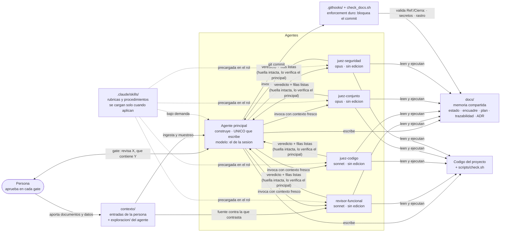
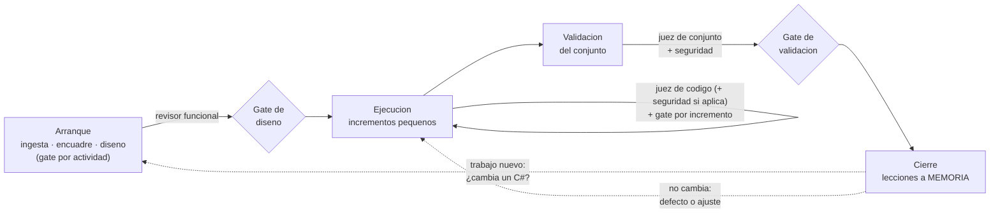
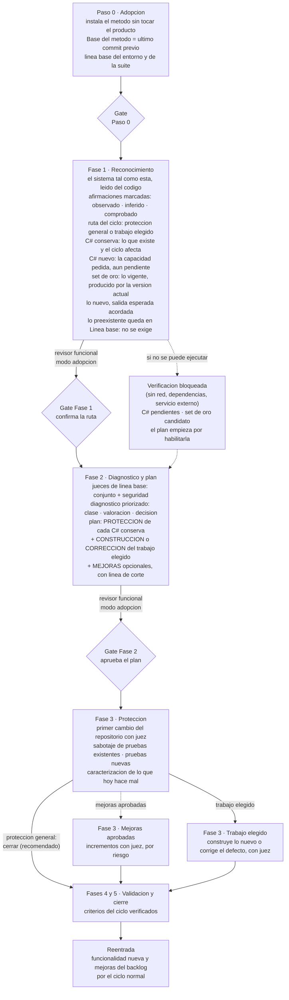

# Plantilla para desarrollar software con agentes de IA

Estructura base para trabajar con un agente de IA (Claude Code, Codex, Cursor…)
de forma **segura y estructurada** en proyectos de software. No es un proyecto en
sí: es una plantilla que copias a tu proyecto real. El agente la sigue paso a
paso, con una **compuerta humana entre cada fase**, antes de escribir la primera
línea de código.

Lo que esta plantilla configura no es un agente sino un **sistema agéntico**: varios
agentes con roles, permisos y memoria distintos, coordinados bajo compuertas humanas.
Un **agente principal** conduce el arranque, construye el código y es el **único que
escribe**. Cuatro **revisores independientes** (revisor funcional, juez de código, juez de
conjunto y juez de seguridad) arrancan con contexto propio, sin herramientas de edición,
y devuelven un veredicto PASA/FALLA con las filas listas para que el principal las
registre; que no tocaron nada lo verifica el principal con la **huella del contenido**
(`scripts/huella.sh`), no la herramienta (`AGENTS.md` §9). Las **skills** son los procedimientos que cada rol carga solo cuando
aplican; `docs/` es la memoria compartida (un lugar por dato, `estado.md` como punto de
reentrada); y lo que no puede fallar vive en **hooks de git**, no en prosa. El detalle de
cada pieza está en «Cómo está armado el sistema» y en el glosario de «Definiciones».

## Cómo usarla

1. Crea la carpeta del proyecto nuevo, entra en ella y copia la plantilla con
   `git archive`: trae exactamente lo versionado en el último commit, sin `.git`, sin
   `mejoras/` ni archivos locales, y con los permisos de ejecución de los hooks.

   ```sh
   mkdir mi-proyecto && cd mi-proyecto
   git -C /ruta/a/agente-software archive HEAD | tar -x
   git init
   git config core.hooksPath .githooks
   git add -A
   sh scripts/check_docs.sh      # debe terminar en verde
   ```

   Si lo extrajiste donde no era, mira antes qué hay (`pwd`, `ls -A`). Si la carpeta solo
   tenía lo de la plantilla, sal y bórrala entera (`cd .. && rm -rf mi-proyecto`). Si ya
   tenía otras cosas, borra solo lo que trajo la plantilla:

   ```sh
   git -C /ruta/a/agente-software archive HEAD | tar -t | grep -v '/$' | xargs rm -f
   rm -rf .claude .githooks .github contexto docs scripts
   ```

   Y el `.git`: si `git init` dijo «Initialized empty…», lo creó la receta y se quita con
   `rm -rf .git`; si dijo «Reinitialized existing…», **ya existía y no se borra**: solo
   `git config --unset core.hooksPath` y `git reset -q`.
2. El agente ejecuta primero el **Bootstrap (paso 0)**: verifica que git esté
   configurado, que los hooks estén activos (`git config core.hooksPath .githooks`),
   que `.env*` esté ignorado y que exista un **remoto** con push inicial (sin
   excepciones: todo proyecto, grande o pequeño, sigue el mismo método). Se hace un
   commit **al cierre de cada fase y de cada incremento** (no solo en la ejecución).
3. **Deja primero tus entradas en `contexto/`.** Es la **única carpeta de entrada**:
   documentos (antecedentes, specs, notas), datos de entrada y de salida, notebooks y
   resultados previos van todos a su raíz, **sin clasificarlos** —el agente los tipifica
   al ingerir—. Es **obligatoria**: necesita al menos un archivo para arrancar —si no
   tienes documentos, escribe un brief breve (guía: `docs/plantilla-requerimiento.md`)—,
   porque el encuadre se **deriva de las entradas**, no de lo que alcances a teclear en
   frío. Todo sistema tiene **entradas y salidas** (archivos, tablas, APIs, pantallas,
   artefactos): deja muestras reales de cada una, o el acceso para obtenerlas; si el
   insumo vive detrás de un servicio o una base de datos, el agente te pedirá
   **conexión/credenciales** para muestrear datos reales antes de suponer.
4. Pídele al agente que ejecute `docs/arranque.md`. Ese guion **empieza ingiriendo
   tus entradas**: inventaría lo que hay, te pregunta si está completo, te propone a
   dónde va cada cosa (gate) y arma un borrador de `docs/encuadre.md`. Recién después
   viene el encuadre, que es **revisar y completar** ese borrador —no llenarlo desde
   cero—, seguido del diseño y la validación. Hay un gate en cada actividad, **antes de
   programar**.

### En un proyecto que ya existe y funciona

**No uses `git archive` ni copies carpetas a mano:** pisarían el README del proyecto y
cualquier archivo con el mismo nombre. La copia la hace un script de la plantilla que
**solo añade lo que falta** y nunca sobreescribe.

1. **Prepara el proyecto.** Necesita al menos un commit con su estado actual y ningún cambio
   sin commitear: ese commit separa tu código de lo que trae el método (será la «Base del
   método»). Si el repositorio aún no tiene commits, revisa que no entre ningún secreto y haz
   uno: `git add -A && git commit -m "Estado antes de adoptar el método"`. Después, una rama
   local para probar: `git switch -c adopcion-metodo`. Nada se publica hasta que tú lo
   decidas; sin remoto, todo sigue en local.
2. **Mira qué pasaría, sin escribir nada.** Desde la carpeta de la plantilla, con la ruta
   de la **raíz** del proyecto:

   ```sh
   cd /ruta/a/agente-software
   sh scripts/adoptar.sh inspeccionar /ruta/al/proyecto [rama-de-integración]   # estado, Git punto por punto, bloqueos e inventario de ramas
   sh scripts/adoptar.sh vista-previa /ruta/al/proyecto   # qué se copia, qué choca, qué se excluye
   ```

3. **Copia.** `sh scripts/adoptar.sh copiar /ruta/al/proyecto` escribe en el proyecto los
   archivos del método que faltan y crea `contexto/adopcion.md`, la lista de lo instalado.
   No hace commit: el commit de instalación lo hace el agente en el paso 4. La primera copia
   se rechaza si el proyecto no tiene commits o tiene cambios sin commitear (paso 1).
   Repetirla es seguro: si nada cambió, no escribe nada.
4. **Pídele al agente, abierto en el proyecto: «arranca sobre proyecto existente».**
   Ejecuta `docs/arranque-existente.md`: te propone cómo integrar cada choque, el
   `.gitignore` (`adoptar.sh gitignore`) y los secretos versionados, registra el entorno,
   activa los hooks y hace el commit de instalación. Después entiende el sistema y protege
   lo que tu trabajo necesita **antes** de cambiar nada.

Qué pasa con lo que el proyecto ya tiene:

| En el proyecto | Qué hace la copia |
|---|---|
| `README.md` | **Nunca se toca.** El agente lo verifica contra el código en la Fase 1. |
| Un archivo con el mismo nombre que uno del método (p. ej. `docs/despliegue.md`) | Se conserva el del proyecto; queda listado como colisión para integrarlo después. |
| `CLAUDE.md`, `AGENTS.md`, hooks o CI propios | Se conservan; el agente propone cómo convivir y tú apruebas. |
| `.gitignore` | No lo toca la copia; `adoptar.sh gitignore` propone las entradas (y una negación precisa si una regla amplia del proyecto tapa un archivo del método) y se niega si ocultarían un archivo ya versionado. |
| El código, las pruebas y los datos | **Nada cambia.** Cualquier cambio posterior entra como incremento con revisión. |

Lo copiado y lo omitido queda registrado en `contexto/adopcion.md`. Si algo salió mal y
no has commiteado, ese manifiesto dice exactamente qué archivos añadió la copia.

## Las 5 fases (con compuerta humana entre cada una)

1. **Encuadre** — contexto, objetivos, no-objetivos, criterios de éxito, set de
   oro, stack y arquitectura, modelo de despliegue —destino local/remoto y
   empaquetado, contenedor recomendado— (`docs/encuadre.md`).
2. **Diseño / plan** — enfoque mínimo e incrementos (`docs/plan.md`); la arquitectura
   se valida con la persona en el README (diagrama gerencial), iterando hasta su OK.
   Antes del gate, el encuadre y el plan pasan una **revisión funcional
   independiente** que verifica completitud y consistencia contra `contexto/`
   (reporta, no escribe).
3. **Ejecución iterativa** — incrementos pequeños, verificados sobre datos reales,
   con revisión crítica independiente antes de cada commit.
4. **Validación** — el conjunto ensamblado contra los `C#` y el set de oro, con
   pasada del juez sobre el conjunto (`docs/definicion-de-hecho.md`).
5. **Cierre y aprendizaje** — lecciones a `docs/MEMORIA.md`.

Además, cuando el proyecto llega a producción, se abre la rebanada de
**Operación/Despliegue** (`AGENTS.md` §2): entorno de prueba, runbook verificado,
protección de datos y autorización explícita, con su propia pasada de juez
(`.claude/skills/desplegando-a-produccion/SKILL.md`).

## Cómo está armado el sistema

Una foto de las piezas y sus relaciones permanentes (sin tiempo: quién invoca, quién
escribe, qué se precarga, qué bloquea). Lo que hace visible: la **asimetría de
permisos** (una sola flecha «escribe»; los revisores no tienen herramientas de
edición y el principal comprueba con la huella del contenido que no tocaron nada), la
**independencia de contexto** de los revisores (solo reciben la invocación, no la
memoria del principal), el **modelo por rol** y que el enforcement actúa sobre el
**commit**, no sobre el agente.



Los roles están declarados en `.claude/agents/` (herramientas, modelo y skill
precargada) y su rúbrica en `.claude/skills/`; ver `.claude/skills/README.md` §Roles.

## Diagrama de la metodología

El orden en que ocurre todo y dónde interviene cada control: la persona en los gates
(uno por actividad del arranque, uno por incremento, y los de diseño y validación), una
revisión independiente en tres momentos, y el arco de reentrada que decide
con una sola pregunta —¿cambia un `C#` o el set de oro?— si el trabajo nuevo vuelve al
encuadre o va directo a la ejecución.



El juez aparece tres veces porque son tres momentos; en el diagrama de componentes
aparece una vez porque es una pieza. El detalle de cada actividad —precondiciones,
validadores PASA/FALLA y gates— está en `docs/arranque.md` (Fases 1–2) y en
`AGENTS.md` §2 (Fases 3–5 y reentrada); no se duplica aquí.

### Diagrama para un proyecto existente

Con código que ya funciona, el método no empieza construyendo: primero entiende y protege lo
que el ciclo necesita conservar. En la primera adopción la persona elige el trabajo: protección
general o un trabajo concreto (una capacidad nueva o una corrección) con protección proporcional. Mismas fases, roles
y hooks; cambia qué produce cada fase.



Hasta el gate de la Fase 2 nada del producto cambia. Primero se entiende y se protege lo que el
ciclo conserva; lo nuevo y las mejoras van después. Diagnosticar no obliga a corregir. El detalle de cada paso, sus validadores y sus
gates está en `docs/arranque-existente.md`; la instalación, en «En un proyecto que ya existe y
funciona», arriba.

## Definiciones

Glosario de los términos y siglas que usa la metodología (y el diagrama):

- **Agente** — entidad que recibe un objetivo, observa su entorno con herramientas
  (lee archivos, ejecuta comandos), decide la siguiente acción y actúa, en bucle, hasta
  cumplirlo o detenerse. Aquí son agentes el principal y cada uno de los cuatro revisores.
- **Agente principal** — el que ejecuta `docs/arranque.md`, conduce a la persona,
  construye el código y registra el rastro. Es el **único que escribe** en el repo;
  hereda el modelo de la sesión.
- **Revisor / subagente** — rol declarado en `.claude/agents/` que el principal invoca
  con **contexto fresco** (no hereda su memoria), herramientas `Read, Grep, Glob, Bash`
  (sin herramientas de edición; `Bash` podría escribir o salir a la red, así que se le
  instruye no hacerlo y el principal **verifica con la huella del contenido**
  (`scripts/huella.sh`) que nada cambió), rúbrica precargada desde `.claude/skills/` y modelo fijo. **Reporta, no
  escribe:** devuelve veredicto y filas listas; el principal las registra. Protocolo
  completo en `AGENTS.md` §9.
- **Sistema agéntico** — el conjunto: los agentes, el **reparto de permisos** entre
  ellos, la **memoria compartida** en `docs/`, las **compuertas humanas** y el
  **enforcement** en hooks. Es lo que esta plantilla configura; ningún agente por sí solo
  lo es.
- **Encuadre** — Fase 1: definir el *problema* (contexto, objetivos, no-objetivos,
  criterios, set de oro, stack, despliegue) antes de diseñar nada. Vive en
  `docs/encuadre.md`.
- **No-objetivos** — lo que queda **fuera de alcance a propósito**. El primer freno al
  sobredimensionamiento.
- **Gate / compuerta** — punto donde la persona **aprueba explícitamente** antes de
  avanzar. No se sigue sin su OK.
- **Bootstrap (paso 0)** — precondición del arranque: hooks activos y ejecutables,
  `.env` ignorado, remoto con push inicial y `check_docs` en PASA. Sin esto, el agente se
  detiene. No hay modo "prueba de concepto" con menos rigor: la distinción complicaba
  sin aportar; un proyecto pequeño se encuadra igual, solo que con menos contenido.
- **`contexto/`** — la **única carpeta de entrada** (obligatoria, ≥1 archivo): documentos
  que se leen y artefactos que se ejecutan o inspeccionan (notebooks, datos de entrada
  y de salida, resultados previos) conviven en su raíz; la persona no clasifica, el
  agente **tipifica** al ingerir (manifiesto en `contexto/README.md`). Su subcarpeta
  `exploracion/` es trabajo del agente (muestreo, experimentos), no fuente.
- **Ingesta** — leer e inspeccionar las entradas de `contexto/`, tipificarlas y
  **rutearlas** a los archivos oficiales (`encuadre.md`, `decisiones.md`,
  `convenciones.md`), inventariando las entradas y salidas del sistema.
- **Entradas y salidas** — toda frontera que el sistema consume o expone (archivos,
  tablas, APIs, eventos, pantallas, artefactos). Cada una es una fila en
  `docs/encuadre.md` §Entradas y salidas con su muestra real en `contexto/` y si fue
  **validada**; el revisor funcional contrasta la tabla contra la carpeta.
- **Insumo** — cualquier **entrada real** del sistema: datos, archivos, respuestas de
  API, conexiones a servicios o bases de datos.
- **Muestreo de insumos reales** — abrir **1 a 3 ejemplos reales** de cada insumo y
  validar contra ellos los supuestos del spec (formato, nombres, casos límite) antes de
  diseñar — pidiendo conexión/credenciales si el insumo vive en un servicio. Barato, y
  evita rediseñar a mitad de camino.
- **Experimento mínimo** — validación barata (en `contexto/exploracion/`) de un **supuesto
  técnico** que condiciona un incremento, antes de construir sobre él. Su resultado es
  un hallazgo; rehacer cuesta más que el experimento.
- **Set de oro** — ≥5 pares `entrada → salida esperada` que definen la **calidad
  aceptable** (no solo que "funcione"), con al menos un ejemplo concreto.
- **Stack** — el lenguaje, framework, build y estilo de arquitectura elegidos.
- **Hallazgo** — un **hecho observado** (p. ej. en el muestreo: "el prototipo no
  implementa el filtro de frescura"). Se **registra como dato** en `docs/encuadre.md`;
  **no es una decisión**. Solo cuando fuerza una elección (≥2 opciones) genera un ADR.
- **ADR** (*Architecture Decision Record*) — registro **ligero** de una decisión que
  tenía más de una opción razonable: contexto, opciones, decisión, razón y
  consecuencias. Viven en `docs/decisiones.md`. Un ADR en estado **`propuesta`** es una
  **decisión diferida**; uno superado se marca **`reemplazada-por:`/`revertida-por:`**
  en su propio estado.
- **Alias** — slug de 2–4 palabras que acompaña a cada `C#`, `I#` y hallazgo
  (`I5 «motor-indicadores»`) para citarlos sin releer documentos. Vive en la columna
  Alias de `docs/trazabilidad.md` (y en `plan.md` para los `I#`).
- **`docs/estado.md`** — el **punto de reentrada** de cada sesión: una página con la
  fase, los criterios con alias y estado, lo abierto y el próximo paso. Se regenera al
  cierre de cada incremento; los demás documentos se abren solo por rebanada.
- **Definición de Hecho** (*DoD, Definition of Done*) — checklist de calidad que un
  incremento debe cumplir para considerarse terminado (`docs/definicion-de-hecho.md`).
- **Revisor funcional (rol analista)** — revisión **independiente** del *encuadre y el
  plan* contra su fuente, al cerrar el arranque. **Reporta, no escribe**
  (`.claude/skills/revision-funcional/SKILL.md`).
- **Juez (rol juez)** — revisión **independiente** del *código* (el diff de cada
  incremento) antes del commit. **Reporta, no edita** (`.claude/skills/revision-critica/SKILL.md`).
- **Juez de conjunto (rol juez)** — la misma rúbrica del juez, aplicada en la **Fase 4**
  al **conjunto ensamblado**: busca los defectos de composición que ninguna revisión por
  incremento puede ver. Sus bloqueantes son `R-F4.n`. **Reporta, no edita**
  (`.claude/agents/juez-conjunto.md`).
- **Juez de seguridad (rol juez)** — auditoría **independiente** de lo *explotable*
  (inyección, control de acceso, secretos, dependencias, IaC, prompt injection), solo
  cuando el incremento toca superficie de riesgo, y una vez sobre el conjunto. Severidad
  × explotabilidad, con confianza. **Reporta, no corrige**
  (`.claude/skills/revision-seguridad/SKILL.md`).
- **Rebanada de Operación/Despliegue** — cómo entra a producción el trabajo: entorno
  de prueba, runbook verificado, protección de datos, autorización explícita y juez
  (`.claude/skills/desplegando-a-produccion/SKILL.md`).
- **Hito** — tres incrementos cerrados desde el anterior, o el momento previo a un
  despliegue. En cada hito corre el juez de conjunto sobre lo ensamblado y se sintetiza
  `docs/MEMORIA.md`: la validación y el aprendizaje no esperan a un cierre que puede
  tardar meses.
- **Plan de pruebas** — qué pruebas son necesarias por incremento (`docs/plan.md`): un
  flujo end-to-end por criterio, unitarios solo donde el flujo no llega, set de oro
  automatizado o manual explícito. La DoD exige exactamente esas; el exceso es hallazgo.
- **Recibo de revisión** — línea estructurada en `docs/revisiones.log` (rol, tipo, alcance,
  veredicto, bloqueantes, seguridad, `huella`, ejecutor) que ata una revisión al contenido
  exacto que juzgó; el `commit-msg` lo exige por transición. No prueba la aprobación
  humana: esa la da la persona en el gate.
- **Resumen ejecutivo (gate)** — la forma de pedir aprobación: qué se decidió escrito en
  texto completo (no por siglas), el cambio en cinco líneas, qué se aprueba y dónde está
  el detalle (`AGENTS.md` §2).
- **Reentrada / triage** — cómo entra el trabajo nuevo *después del cierre* (Fase 5): lo
  **dispara el cierre** y **no re-ejecuta el arranque** —solo la rebanada que el cambio
  necesita—. Una sola pregunta —¿cambia un `C#` o el set de oro de `encuadre.md`?— decide
  si reabre el **Encuadre** (un *ajuste* que edita un criterio, o un *requisito nuevo* que
  añade uno) o va directo a la **Fase 3** (defecto, regresión o ajuste interno). Detalle
  en `docs/arranque.md`.
- **Trazabilidad** — el hilo `criterio → incremento → revisión`, con estado
  (`docs/trazabilidad.md`).
- **`C#`** — IDs de los **criterios** de éxito/aceptación (`C1`, `C2`…), en
  `encuadre.md`.
- **`I#`** — IDs de los **incrementos** del plan (`I1`, `I2`…), en `plan.md`.
- **`R-E.n`** — IDs de los **vacíos** que detecta el *revisor funcional* en el arranque
  (p. ej. `R-E.1`); se cierran antes del gate de diseño.
- **`R-I#.n`** — IDs de los **hallazgos bloqueantes** del *juez* en un incremento
  (p. ej. `R-I3.1`); `R-S#.n` los del *juez de seguridad* y `R-F4.n` los del *juez de
  conjunto* (Fase 4). Misma tabla y mismo ciclo en `docs/trazabilidad.md`.
- **Commit enlazado** — commit cuyo mensaje referencia lo que resuelve: `Ref: F#`
  (cierre de fase — `F1`, `F2`, `F4`, `F5`), `Ref: I3` (incremento de la Fase 3),
  `Cierra: R-I3.1` / `R-S3.1` / `R-F4.1` (hallazgo de un juez) o `Cierra: R-E.1` (vacío
  del revisor funcional).

## Los mecanismos que la sostienen

- **Compuertas (gates):** tú apruebas explícitamente entre fases. No se avanza sin
  tu OK.
- **Registro de decisiones:** toda decisión con más de una opción razonable queda
  en `docs/decisiones.md` (ADR-lite). Trazabilidad y aprendizaje.
- **Guardas anti-sobredimensionamiento:** complejidad solo cuando se necesita.
  Riesgo típico en software: abstracción prematura y dependencias especulativas.
- **Contexto compacto:** el agente reentra cada sesión por `docs/estado.md` y abre lo
  demás por rebanada; cada dato vive en un solo lugar y se referencia por
  `ID «alias»`; los documentos vivos se compactan en momentos fijos —cierre de
  incremento, de fase y de ciclo— (el detalle queda en git, el porqué en los ADR).
  Las skills solo se cargan cuando aplican.
- **Ciclo de aprendizaje:** `corrección → docs/MEMORIA.md → (si se repite) → skill`.

## Enforcement: lo que no puede fallar

Las reglas "duras" no se quedan en prosa: la plantilla trae git hooks en `.githooks/`.
Actívalos una vez por proyecto:

```bash
git config core.hooksPath .githooks
```

- **`pre-commit`** — bloquea versionar un `.env`/secreto; exige que **lo verificado sea
  lo versionado** (rechaza si hay archivos rastreados con cambios sin stagear); corre
  `scripts/check_docs.sh` sobre una **exportación del índice** (contrato documental por
  fase: archivos obligatorios, `C#` e `I#` únicos y existentes, ADRs referenciados,
  frontmatter válido, hooks activos); y corre `scripts/check.sh` (lint + formato + tests;
  lo creas en el diseño), **obligatorio desde la Fase 2**, sobre una **instantánea** de lo que se
  commitea con su propio repositorio git temporal (un archivo ignorado no sostiene la suite; lo
  no versionado que necesite, como el entorno virtual, se declara en `docs/convenciones.md`), y
  rechaza que la suite cambie el contenido, el modo o la existencia de un archivo versionado. Los scripts se invocan con
  intérprete explícito: su ausencia es fallo, no aviso.
- **`commit-msg`** — valida **todos** los trailers contra una gramática cerrada
  (`Ref: F1|F2|F4|F5`, `Ref: I<n>` que existe en `plan.md`, `Ref: hito:I<a>-I<b>`,
  `Cierra: R-E.n | R-I#.n | R-S#.n | R-F4.n | R-SF4.n` con fila en Estado
  `resuelto|verificado`), rechaza familias desconocidas, exige por transición un **recibo
  de revisión vigente** en `docs/revisiones.log` (el último del rol y alcance, en PASA, con
  `huella` igual a la del índice; `Ref: I<n>` → juez de código más seguridad si la declaró
  requerida, sin hallazgos `R-I<n>.*`/`R-S<n>.*` abiertos, con `- [x] I<n>` en el plan y
  `docs/estado.md` regenerado en el commit, y como máximo tres incrementos
  cerrados —commits `Ref: I<k>`— desde el último commit `Ref: hito:…`; `hito:I<a>-I<b>` →
  juez de conjunto (más seguridad, misma huella) sobre un rango que existe en el plan y
  cuyos incrementos ya tienen su commit; `F2` → revisor funcional (una `reentrada:C<n>`
  nombra un criterio existente) y ningún vacío abierto; `F4` →
  juez de conjunto, no un hito; `F5` → el de F4 sigue vigente), **solo deja entrar código
  del producto con `Ref: I<n>`** (un `Cierra:` o un `Ref: F#` no acreditan revisión), y un
  `Ref: F4|F5` dispara `scripts/check_docs.sh cierre` (condiciones de salida del ciclo:
  nada `abierto` ni `resuelto` sin `verificado`, al menos un `C#` y todos verificados con
  incremento, sin ADR en `propuesta` ni ADR-000). Ata además el trabajo al **contrato
  revisado**: `Ref: I<n>|hito|F4|F5` exigen que los `- C<n>:` y el set de oro de
  `encuadre.md` sean los del último commit `Ref: F2` (en adoptados, posterior a la Base del
  método; una `reentrada:C<n>` solo puede haber cambiado ese criterio), ningún hallazgo con
  fila en HEAD desaparece, `resuelto|verificado` llevan una referencia que resuelve (ruta del
  índice o commit) y `estado.md` no entra a F5 sin `Ref: F5`. Escape puntual: `git commit --no-verify`.
- **`scripts/check_docs.sh`** a mano, al **inicio de cada sesión**: además de lo anterior
  verifica `core.hooksPath` y el bit ejecutable de los hooks (git ignora en silencio un
  hook no ejecutable).
- **`.editorconfig`** — estilo base (charset, espacios) que aplican los editores.

Los hooks son locales y esquivables (`git commit --no-verify`): con remoto compartido,
`scripts/check.sh`, `scripts/check_docs.sh`, `scripts/pruebas/validar_historial.sh` y
`scripts/pruebas/regresion.sh` se cablean también en CI (ver `docs/convenciones.md` §Git).
**`validar_historial.sh`** reejecuta el contrato de los hooks sobre cada commit de un rango
(`origin/main..HEAD` por defecto): trailers, recibos vigentes por huella, hito, código solo
con `Ref: I<n>`, las mismas guardas de contenido del `pre-commit` (`scripts/guardas.sh`:
secretos, append-only, registros y suite que no desaparecen) y `check_docs` sobre el árbol
del commit. Un merge **limpio** (su árbol es exactamente la fusión automática de sus padres)
pasa sin trailer; uno que **añade contenido al fusionar** (resolución de conflictos, archivo
nuevo) se valida como cualquier commit, local y remotamente. Es lo que hace que un
`--no-verify` local falle en el remoto. («Doctor» es `scripts/check_docs.sh`, el validador
documental del método; no el `/doctor` de Claude Code.) Doctor, hook y replay leen `docs/trazabilidad.md`
con un solo lector (`scripts/trazabilidad.sh`), el plan con una sola gramática de
incremento (`check_docs.sh plan`) y los recibos con un solo parser (`scripts/recibos.sh`):
una fila, un incremento o un recibo significan lo mismo en los tres.
**`regresion.sh`** es la regresión de los propios hooks: autocontenida (toma de este
repositorio solo la instrumentación y genera un proyecto sintético), crea repositorios
temporales sin red ni credenciales y comprueba cada regla con su caso negativo y su caso
positivo (fase ilegible, código sin recibo, suite en rojo, recibo caducado, hito sin
cobertura, fila invisible, cierre vacío, rol ausente, YAML ilegal, mutante no acreditado…).
Da el mismo resultado en la plantilla vacía y dentro de un proyecto con código; es lo que se
ejecuta antes de tocar un hook o un script de la plantilla.

**Límites declarados** (lo que ningún hook local prueba): quién ejecutó una revisión
(`ejecutor=` es dato declarado; el recibo ata el veredicto al contenido, no a una sesión),
que el revisor no usó red (las huellas no la ven), y la aprobación humana (vive en el
chat, no en un archivo). Lo primero se cubre con CI y hooks del cliente (`SessionStart`,
`PreToolUse`) que **cada proyecto integra**: la plantilla trae el workflow de ejemplo, no
los instala ni los activa en el remoto; lo último es deliberado.

Que el juez y el revisor funcional corrieron se exige por su rastro: cada revisión deja
su **recibo** en `docs/revisiones.log` (rol, alcance, veredicto, huella; también con PASA
limpio) y sus bloqueantes/vacíos en `docs/trazabilidad.md`; el `commit-msg` no acepta la
transición sin el recibo vigente. Desde el marcador `# contrato-recibos: 2` del registro, cada
recibo nuevo declara también `modalidad`, `filtro` y `aislamiento` (lo declarado, no una prueba
de aislamiento) y puede atar evidencia en `docs/revisiones/<id>/` por su propia huella: el
`pre-commit` y el replay rechazan un recibo nuevo sin esos campos y una evidencia registrada que
falte o cambie. Un registro de una versión anterior se migra añadiendo el marcador al final;
el replay sigue aceptando los commits hechos con esa versión (los juzga con el contrato con que se
hicieron) y la instrumentación del contrato no puede retroceder. Los campos se separan con un espacio.
Y la **regla del segundo hallazgo** (`AGENTS.md` §8) convierte en linter/hook todo
hallazgo mecanizable que se repita.

## Portabilidad: pensada para Claude Code, con adaptador para Codex

La plantilla **asume que el agente es Claude Code**: las skills viven en
`.claude/skills/` (su ubicación nativa, donde las autodescubre sin symlinks ni copias
que sincronizar) y los cuatro roles de revisión (revisor funcional, juez de código, juez
de conjunto y juez de seguridad) están declarados en `.claude/agents/` con su skill
precargada. `AGENTS.md` es la **fuente de verdad** de las instrucciones —es el estándar
que varias herramientas leen de forma nativa—; `CLAUDE.md` solo lo importa
(`@AGENTS.md`) más notas propias de Claude Code.

> Una regla en `AGENTS.md` moldea el comportamiento del agente pero no lo garantiza. Lo
> que no puede fallar va en git hooks y CI, que son iguales en cualquier herramienta.
> Y en ninguna herramienta la plantilla aísla por sí sola a los revisores: en todas,
> «no escribe» es instrucción + verificación del principal con la huella del contenido
> (`AGENTS.md` §9).

### Si vas a usar otra IA (instrucciones para el agente)

Agente: si tu herramienta no es Claude Code, ejecuta este ajuste **una sola vez, antes
del Bootstrap**, registra lo que cambies en un commit propio, y **no borres** los roles
de `.claude/agents/`: son la referencia de qué debe hacer cada rol en tu adaptador.

1. **Instrucciones.** `AGENTS.md` es el canon y probablemente tu herramienta ya lo lee.
   Si usa otro archivo (p. ej. reglas propias del editor), créalo **importando o
   remitiendo a** `AGENTS.md`; no dupliques contenido. `CLAUDE.md` puede quedarse (no
   estorba) o eliminarse.
2. **Skills.** Son markdown con frontmatter `name` + `description`, el mismo formato que
   leen otras herramientas; están referenciadas **por ruta** desde `AGENTS.md` y `docs/`,
   así que cualquier agente que lea archivos las usa tal cual. Si tu herramienta tiene
   autodescubrimiento en otra carpeta, **enlázala o cópiala** allí; si prefieres
   moverlas, actualiza toda referencia (`grep -rl '\.claude/skills/' --include='*.md' .
   scripts/`) y los chequeos 5 y 6 de `scripts/check_docs.sh`.
3. **Roles de revisión.** Si tu herramienta declara subagentes, crea uno por rol con el
   **cuerpo de `.claude/agents/<rol>.md`** como instrucción, la orden de leer su skill
   (`.claude/skills/<skill>/SKILL.md`) al arrancar —si no puede precargarla— y el modelo
   del rol. Si no declara subagentes, el **«Prompt de invocación»** de cada skill de
   revisión lanza la pasada en otra sesión o chat. Lo que no puede perderse, en ambos
   casos: **contexto propio** (no hereda el hilo de quien construyó), **un revisor a la
   vez**, veredicto PASA/FALLA con el **formato del protocolo** (`AGENTS.md` §9) y el
   rastro en `docs/plan.md` + `docs/trazabilidad.md`.
4. **Enforcement.** `.githooks/`, `scripts/check_docs.sh` y `.editorconfig` son
   git/shell puro: funcionan igual con cualquier herramienta. No los toques.
5. **Verifica el ajuste:** `sh scripts/check_docs.sh` debe dar PASA y ninguna ruta
   referenciada en `AGENTS.md`/`docs/` puede quedar rota. Registra el ajuste como
   commit con su porqué.

### Adaptador concreto: OpenAI Codex (verificado contra su documentación, oct. 2026)

- **Instrucciones:** Codex lee `AGENTS.md` de forma nativa. Nada que hacer.
- **Skills:** Codex descubre `.agents/skills/<nombre>/SKILL.md` (desde el directorio de
  trabajo hasta la raíz del repo) con frontmatter `name` + `description`, y carga el
  cuerpo solo cuando la skill aplica —el mismo contrato que esta plantilla—. **No lee
  `.claude/skills/`**: crea `.agents/skills` como **enlace simbólico** a `.claude/skills`
  —el destino de un enlace relativo se resuelve desde la carpeta que lo contiene, así que
  es `mkdir -p .agents && ln -s ../.claude/skills .agents/skills`, no `ln -s
  .claude/skills …`— y comprueba que resuelve (`ls .agents/skills/` debe listar las nueve
  skills); o copia la carpeta. Con enlace no hay dos copias que sincronizar (en Windows,
  copia). Esto verifica el enlace, no que tu versión de Codex cargó las skills: eso se
  comprueba en Codex.
- **Roles:** Codex declara subagentes como archivos **TOML** en `.codex/agents/` (uno por
  rol), con `name`, `description`, `developer_instructions` (el cuerpo del `.md` del rol,
  más «lee `.claude/skills/<skill>/SKILL.md` antes de empezar», porque Codex **no
  precarga skills** en un agente) y `model`. Dos diferencias que debes saber: (a) el
  subagente **hereda** el sandbox, las aprobaciones, el proveedor y los servidores MCP
  del principal —un archivo de agente **no puede** darle un sandbox de solo lectura
  propio—, así que «no edita» es exactamente lo que ya es aquí: instrucción + huellas
  de integridad y vigencia del principal (`scripts/huella.sh`; no ve red ni ignorados);
  (b) no existe `tools:` por rol; lo más cercano es
  `features.shell_tool = false`, que **no** sirve a los revisores porque necesitan
  ejecutar `scripts/check.sh`.
- **Modelos:** `sonnet` y `opus` en `.claude/agents/` son alias de Claude Code, no
  equivalencias universales. Elige el modelo del proveedor que cumpla la misma función
  (acotado y barato para las revisiones por rúbrica; el más fuerte para conjunto y
  seguridad), **registra el modelo realmente resuelto** por rol en `docs/MEMORIA.md`
  §Operativa y, si hubo opciones, como ADR.
- **Un revisor a la vez (RAM):** en `~/.codex/config.toml`,
  `agents.max_concurrent_threads_per_session = 1`. Es la regla de `AGENTS.md` §3 hecha
  configuración.
- **Hooks de Codex:** si tu versión ofrece hooks locales de ciclo de vida, úsalos para
  avisos; **lo que no puede fallar sigue en `.githooks/`**, que no depende del cliente.
- **Verifica, no asumas:** la documentación cambia. Antes de confiar en el adaptador,
  comprueba en tu versión que Codex cargó `AGENTS.md`, listó las skills y resolvió el
  modelo de cada rol; anota lo que difiera en `docs/MEMORIA.md`.

## Estructura

```
.
├── AGENTS.md            instrucciones del proyecto (canónico)
├── CLAUDE.md            importa AGENTS.md + notas de Claude Code
├── README.md            este archivo
├── docs/
│   ├── arranque.md          guion de arranque (primer punto de entrada)
│   ├── estado.md            estado vivo: punto de reentrada de cada sesión
│   ├── encuadre.md          encuadre + set de oro + stack/arquitectura
│   ├── plan.md              plan vivo + bitácora + backlog
│   ├── trazabilidad.md      hilo criterios ↔ incrementos ↔ hallazgos (+ alias)
│   ├── decisiones.md        ADR-lite (con ciclo de vida del estado)
│   ├── convenciones.md      cómo hacemos las cosas aquí
│   ├── definicion-de-hecho.md
│   ├── despliegue.md        runbook vivo: dónde está cada cosa, cómo se despliega, verifica y revierte
│   ├── revisiones.log       recibos de revisión (una línea estructurada por pasada; append-only)
│   ├── revisiones/          evidencia conservada de una revisión (una carpeta por recibo; se crea al usarla)
│   ├── plantilla-requerimiento.md   cómo escribir un requerimiento (inicial y de reentrada)
│   └── MEMORIA.md           lecciones del proyecto
├── contexto/            única carpeta de entrada (obligatoria): documentos, datos y
│   └── exploracion/         artefactos sin clasificar; exploracion/ es trabajo del agente
├── .claude/
│   ├── skills/          las skills, en su ubicación nativa de Claude Code — una carpeta
│   │   └── <nombre>/        por skill con SKILL.md (frontmatter name + description) y
│   │       └── SKILL.md     references/ si aplica; se cargan solo cuando disparan
│   └── agents/          roles de revisión declarados (revisor funcional, juez de código,
│                        juez de conjunto, juez de seguridad) con su skill precargada
├── scripts/
│   ├── check_docs.sh        integridad del rastro documental (pre-commit, commit-msg y a mano)
│   ├── huella.sh            huellas: vigencia (lo revisable: todo salvo revisiones.log,
│   │                        trazabilidad, estado y MEMORIA) e integridad (todo el árbol)
│   ├── recibos.sh           parser único de revisiones.log (hook y doctor)
│   ├── trazabilidad.sh      lector único de trazabilidad.md (doctor, hook y replay)
│   ├── guardas.sh           guardas de contenido entre dos estados (pre-commit y replay)
│   ├── consumo.py           tokens por modelo y origen (principal, subagentes, sin atribuir) desde los transcripts locales
│   ├── buscar.sh            búsquedas registradas (git grep contra un commit; evidencia
│   │                        append-only citable como B-<n>; usado en la adopción)
│   └── pruebas/
│       ├── regresion.sh     regresión de los hooks y scripts (repos temporales; sin red)
│       └── validar_historial.sh  el contrato de los hooks sobre cada commit de un rango (CI)
├── .githooks/           hooks versionados (commit-msg enlazado; pre-commit: secretos + checks)
├── .github/workflows/   metodo.yml: la CI mínima (doctor, contrato por commit, regresión, suite)
├── .editorconfig        estilo base agnóstico del lenguaje
└── .gitignore
```

---

> **En tu proyecto, este README lo reemplaza el agente, no tú.** En el diseño (Fase 2,
> `docs/arranque.md`) cambia el contenido de arriba por el README del proyecto (formato:
> `.claude/skills/escribiendo-readme/SKILL.md`): qué resuelve, diagrama gerencial,
> estructura, entradas/salidas y cómo ejecutarlo. Lo valida contigo antes del gate y lo
> mantiene al día en cada fase. Lo sustantivo (objetivos, criterios, stack) vive en
> `docs/encuadre.md`.
